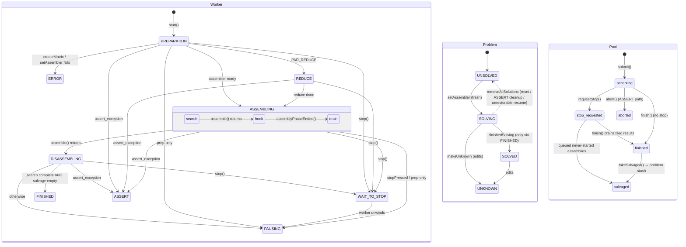

# Solver start / pause / stop lifecycle

**Date:** 2026-10-13
**Scope:** `src/lib/solvethread.{h,cpp}`, `src/lib/problem.{h,cpp}`,
`src/lib/disassemblerpool.{h,cpp}`, `src/gui/mainwindow.cpp` (solver buttons +
poll loop). Written against PR #156
(`fix/solver-stop-stash-finished`); line numbers below refer to that branch.
**Status:** Normative for the lifecycle. PR #156 fixed one guard in this chart
(`FINISHED` now requires an empty salvage); this doc records the whole machine
so the next race has a chart to point at instead of a comment to find.

## 1. Four actors, not one

There is no single "solver state". Three state machines plus a poll loop interact:

| Actor | States | Lifetime | Owner thread writes |
| :--- | :--- | :--- | :--- |
| `solveThread_c::action` (`solvethread.h:79`) | `PREPARATION REDUCE ASSEMBLING DISASSEMBLING PAUSING FINISHED ERROR ASSERT WAIT_TO_STOP` | One `solveThread_c` per run; destroyed by the GUI after the run ends | worker (plus `stop()` → `WAIT_TO_STOP`) |
| `problem_c::solveState` (`problem.h:54`) | `UNSOLVED SOLVING SOLVED UNKNOWN` (+ freestyle via edits) | Persistent across runs, saved to file | worker (`setAssembler`, `finishedSolving`, `removeAllSolutions`, `makeUnknown`); GUI edits |
| `disassemblerPool_c` (`disassemblerpool.h:136`) | accepting → stop-requested → finished; aborted | Owned by the `solveThread_c` (`disasm_pool`, null in assembly-only mode) | worker + pool workers/merger |
| GUI (`mainwindow.cpp`) | `assmThread == 0` vs alive; Start/Cont/Stop enabled flags | Whole session | GUI thread polls `currentAction()` in `update()` (`mainwindow.cpp:3521`) and destroys the thread object on `PAUSING` / `FINISHED` / `ERROR` |

`stopped()` (`solvethread.h:389`) is `PAUSING | FINISHED | ERROR | ASSERT`.
`WAIT_TO_STOP` is deliberately **not** stopped: it is the transient "please wait"
(`mainwindow.cpp:3383`) between `stop()` and the worker unwinding.

## 2. Statechart

`Continue` is not a transition: it is `start()` again on a `SOLVING` problem whose
assembler survived. The run re-submits the stash **first** (`solvethread.cpp:112`),
then resumes the drained search; overlap is suppressed by the assembler's
`emittedSignatures` dedup. Order stability comes from submitting the stash first
and from the pool's ordered merger (`SPEC-DIS-1`).

## 3. Transition table (worker)

| # | Event / source | Guard | Effect | Target |
| --- | :--- | :--- | :--- | :--- |
| T1 | `start()` | fresh object (`!running && !joinable`, else throw); problem startability is checked worker-side, rejecting to `ACT_ERROR` | `stopPressed=false`, spawn worker | `PREPARATION` (ctor value) |
| T2 | prep | `createMatrix` / `setAssembler` fails | publish `errState/errParam`, (`ERR_CAN_NOT_RESTORE_INTERRUPTED` also drops resume state, `problem.cpp:936`) | `ERROR` (terminal) |
| T2b | run entry | `!canStartSolving()` (solved/invalidated without reset) | `ERR_CAN_NOT_START`, problem untouched (rejection is `ERROR`, not `ASSERT`, precisely so valid results survive) | `ERROR` (terminal) |
| T2c | prep | saved assembler state undecodable (version/syntax) | resume bytes dropped, `SS_SOLVING` kept with partial results viewable; `canStartSolving()` goes false so a retry lands in T2b instead of failing here again | `ERROR` (terminal) |
| T3 | prep | `return_after_prep` (Prepare button) | assembler kept, no search | `PAUSING` |
| T4 | `stop()` in `PREPARATION REDUCE ASSEMBLING DISASSEMBLING` (`solvethread.cpp:422`) | — | `WAIT_TO_STOP` + `assembler->stop()` + `pool->requestStop()` + `stopPressed=true` | `WAIT_TO_STOP` |
| T5 | `stop()` in any other action | — | no-op (idempotent; double-Stop safe) | unchanged |
| T6 | `assemble()` returns | — | test hook `assemblyPhaseEnded()` (`solvethread.cpp:161`), freeze assembly cost clock | `DISASSEMBLING` label (skipped if `stopPressed`) |
| T7 | `finish()` + `takeSalvaged()` (`solvethread.cpp:171`) | `getFinished() >= 1 && salvage.empty()` — the PR #156 guard | `finishedSolving()` → `SS_SOLVED` | `FINISHED` (terminal) |
| T8 | same | search incomplete **or** anything salvaged | stash stays for next run | `PAUSING` (terminal, `SS_SOLVING` kept) |
| T9 | `stopPressed` before search | stash re-submit skipped (`solvethread.cpp:112`), `assemble()` skipped | `addTime()` | `PAUSING` |
| T10 | `assert_exception` anywhere in `run()` | — | `pool->abort()` (if any), `removeAllSolutions()` → `SS_UNSOLVED` | `ASSERT` (terminal) |
| T11 | GUI `update()` poll (`mainwindow.cpp:3521`) | `PAUSING | FINISHED` (also `ERROR`, `ASSERT` w/ dialog) | `assmThread.reset()` → dtor `stopInternal()` (no-op) + `join()` | no thread; buttons re-derive from `solveState` (`mainwindow.cpp:3454`) |
| T12 | `~solveThread_c()` (`solvethread.cpp:252`) | worker still alive | `stopInternal()` + `join()` on the destroying thread — an implicit stop | — |

Notes that bite:

- On **Continue** the worker never visits `REDUCE` and, if the assembler already
  exists, never visibly leaves `PREPARATION` until `ASSEMBLING`: the ctor value
  persists through the assembler-reuse branch (`solvethread.cpp:55`). Poll loops
  must not treat "still `PREPARATION`" as "still preparing".
- `WAIT_TO_STOP` is always overwritten by the worker (T8/T7/T9) — it is never
  terminal, and a second `stop()` during it is a no-op (T5).
- `ERROR` on a fresh problem leaves `SS_UNSOLVED`, so Start stays legal;
  `ASSERT` wipes to `UNSOLVED` too, discarding partial solutions by design.
- Assembly-only mode (`disasm_pool == null`) skips T7's second conjunct:
  `FINISHED ⇔ getFinished() >= 1`, no stash exists.

## 4. Lifecycle invariants

Defined canonically as `LIFECYCLE-n` in the `solveThread_c` contract comment
(`src/lib/solvethread.h`), quoted here with enforcement pointers the way
`SPEC-DIS-n` / `SPEC-POOL-n` are quoted for the pools.

| ID | Invariant | Enforced by |
| :--- | :--- | :--- |
| LIFECYCLE-1 | `FINISHED ⇒ SS_SOLVED ∧ getFinished() >= 1 ∧ stash empty` (PR #156) | `solvethread.cpp:192`; test `stop after the search completes…` + guard test below |
| LIFECYCLE-2 | `PAUSING ⇒ SS_SOLVING ∧ assembler present` (resume state survived) | all `PAUSING` assignments keep `assm`; guard test below |
| LIFECYCLE-3 | `stop()` is total and idempotent: legal in every action, mutating only T4 | `stopInternal` guard (`solvethread.cpp:422`); guard test (stop-after-finish no-op) |
| LIFECYCLE-4 | `start()` requires no live thread; unstartable problems fail the run to `ACT_ERROR` with `ERR_CAN_NOT_START`, problem untouched | `start()` throws on reuse; `run()` entry rejects worker-side (all build modes); `canStartSolving()` gates (`burrTxt2.cpp:198`, GUI Start-resets flow) |
| LIFECYCLE-5 | Every assembly is enqueued ∨ salvaged ∨ delivered, never lost (pool half) | `SPEC-DIS-5`; stash re-submit-first (`solvethread.cpp:112`) + dedup |
| LIFECYCLE-6 | `takeSalvaged()` runs only after `finish()`; pool drain only after workers join | header contract (`solvethread.h:41`); `run()` ordering (`solvethread.cpp:171`) |

## 5. Edge-case catalog

Handled today; recorded so a refactor can check it didn't drop one.

- **E1 — Stop during `PREPARATION`, before `setAssembler`.** The worker still
  builds the assembler and flips `UNSOLVED → SOLVING`, then sees `stopPressed`
  and parks (`PAUSING`). A "cancelled" prep therefore leaves a resumable
  assembler and enables Continue. Deliberate: preparation is short and never
  half-persisted.
- **E2 — Stop during `REDUCE`.** `reduce()` is synchronous; `stop()` only sets
  the flags (T4). The worker finishes reducing, persists the assembler, then
  parks. `WAIT_TO_STOP` is shown meanwhile.
- **E3 — Prepare-only (`return_after_prep`).** Parks with a fresh assembler and
  untouched stash. Continue searches normally.
- **E4 — Stop pressed before a run starts (stale flag).** `start()` clears
  `stopPressed` (T1), so a previous run's Stop never leaks into the next run.
  Conversely a Stop that lands before the stash re-submit skips the re-submit
  (T9) and the stash simply waits one more run — no loss.
- **E5 — Stop between `assemble()` return and `finish()`.** The PR #156 window:
  search complete, pool salvages the queue, run parks (T8), Continue re-submits
  the stash. Covered by the `stopAfterSearchSolveThread_c` regression test.
- **E6 — Stop mid-drain.** Filed results are still delivered, in-flight jobs run
  to completion, only never-started assemblies are salvaged. Counts are partial,
  stash non-empty → `PAUSING`. Continue completes the tail.
- **E7 — No stop, clean run.** Salvage empty, `FINISHED` + `SS_SOLVED`, Cont
  disabled. The stash is empty by construction (LIFECYCLE-1).
- **E8 — Assembly-only mode.** No pool, no stash, no re-submit; `stop()` reaches
  only the assembler. `assembly()` callback always returns true; stopping relies
  on the assembler's stop token.
- **E9 — Unrestorable resume.** `ERR_CAN_NOT_RESTORE_INTERRUPTED` drops
  solutions *and* saved state and reports the error, so the next solve restarts
  clean instead of failing on the same bytes forever (`problem.cpp:936`).
  `ERR_CAN_NOT_RESTORE_VERSION` / `ERR_CAN_NOT_RESTORE_SYNTAX` keep `SS_SOLVING`
  with the partial results viewable but drop the undecodable resume bytes
  (T2c): `canStartSolving()` goes false, so a retry is rejected up front as
  `ERR_CAN_NOT_START` (T2b) instead of failing to decode again — and the
  problem is never left `UNSOLVED` with nonzero counters plus stale resume
  data, which the fresh `setAssembler()` path must reject. A file whose
  `state` attribute decodes outside the enum fails closed to `SS_UNKNOWN`
  (`problem.cpp`, load ctor) for the same reason.
- **E10 — `assert_exception` in the worker.** Pool aborted, solutions wiped,
  `ASSERT` published; the GUI reaps it via `stopped()` and shows the assert
  window instead of hanging (`mainwindow.cpp:3504`). Partial results are
  intentionally discarded — an assert means the search itself is untrusted.
- **E11 — Destroying a running `solveThread_c`.** Destructor stops and joins on
  the destroying thread. The GUI only destroys after polling a terminal action,
  so the join is immediate; the test subclass joins in its own dtor because the
  hook runs on the worker (`test_disassembler_pool.cpp:574`). Never destroy
  from the worker itself.
- **E12 — `start()` while running.** Was unguarded in
  `solveThread_c::start()` and GUI-prevented only. Now enforced: a second
  `start()` on a live or already-run object throws `assert_exception` via
  `bt_te()` in all build modes (one object per run — the `reportedProgress`
  monotone guard assumes a fresh object per solve). The GUI's
  `bt_assert(assmThread == 0)` (`mainwindow.cpp:1105`) is the remaining
  debug-only link in that chain; it is unreachable while Start/Cont stay
  disabled during a run, and lib-level enforcement now catches any path
  through anyway.
- **E12b — `start()` on an unstartable problem.** Deliberately NOT thrown in
  `start()`: `test_solver.cpp:1712` pins the contract that such a run ends
  stopped (`stopped()` must terminate the `burrTxt2`-style poll), and neither
  `burrTxt2` nor `lib_interface` catches around `start()`. Enforcement lives
  worker-side at `run()` entry (T2b) — `canStartSolving()` is checked before
  either the assembler-reuse branch or the fresh `setAssembler()` path, in all
  build modes. Placing it anywhere later leaves a bypass: the reuse branch
  never calls `setAssembler()`, so a check there alone still silently re-"solves"
  an `SS_SOLVED` problem with a live assembler in release (caught by the release
  run of the guard test, which failed exactly that way).
- **E12c — why `ERROR`, not `ASSERT`.** The first cut rejected worker-side via
  a throw, ending in `ACT_ASSERT` — but the assert handler calls
  `removeAllSolutions()`, so starting an `SS_SOLVED` problem wiped valid
  results, and the GUI presented the internal-error dialog for a usage error.
  `ERR_CAN_NOT_START` keeps the rejection poll-visible and non-destructive:
  the problem is left exactly as it was. Frontends that can avoid the wasted
  run gate on `canStartSolving()` first (`burrTxt2.cpp:198`).
- **E13 — `stop()` from the worker thread (test hook).** Safe: `stop()` never
  joins, only publishes flags. The worker's own final assignment overwrites
  `WAIT_TO_STOP` (T7/T8). GUI-thread `stop()` and worker-thread `stop()` compose
  because both funnel through the same flags.
- **E14 — Save / load mid-pause.** Assembler state plus stash serialize with the
  problem (`stashedAssemblies` tag); loading restores `SS_SOLVING`; the next
  `start()` re-submits the stash first. Stop-save-load-continue loses nothing.
- **E15 — Edits while `SOLVING`/`SOLVED`.** `makeUnknown()` / freestyle paths
  invalidate the resume state and discard the stash with it (`problem.h:114`);
  `canStartSolving()` goes false and Cont disables. The stash is part of the
  resume state, never independent of it.
- **E16 — Inline (single-threaded) pool.** `submit()` runs synchronously, so
  `requestStop` has no queue to salvage; `takeSalvaged()` is empty and T7/T8
  behave as if unstopped. The lifecycle is identical, only the race windows
  shrink.
- **E17 — Error paths skip time accounting.** `ERROR`/`ASSERT` exits never call
  `addTime()`; only `PAUSING`/`FINISHED` do. Preparation failures therefore
  contribute no used-time. Accepted: nothing searchable ran yet.

## 6. SCXML: evaluated, not adopted

SCXML (W3C State Chart XML — executable statecharts, e.g. Qt SCXML, uSCXML,
Apache Commons SCXML) was considered for encoding §2 as a machine-readable
artifact. Verdict: **do not adopt**, neither as runtime nor as documentation
format.

1. **The chart is the easy part; the protocols are the hard part.** An SCXML
   engine executes one chart — it does not verify anything. The defect class
   that keeps biting (lost wakeups, salvage races, token leaks) lives in the
   *interleavings* of the assembler pool, the disassembly pool, and the shared
   `ThreadBudget`. Those are already modeled in PlusCal/TLA+ under `spec/`
   (`DisasmPool.tla`, `AssemblyPool.tla`, `Pipeline.tla`) and checked over all
   small-instance interleavings with TLC. SCXML would duplicate that layer with
   strictly weaker guarantees and a second source of truth.
2. **Runtime interpreter is an impedance mismatch.** Transitions here are driven
   by thread joins, atomic flags, and pool drains — not by events dispatched
   into an interpreter. Hosting the worker lifecycle in an SCXML engine would
   add a dependency (no SCXML engine is vendored; the GUI is FLTK, not Qt) and a
   new thread-hazard class in exchange for no runtime capability the three
   atomics don't already provide.
3. **As pure documentation, Mermaid wins.** `design/` already renders Mermaid
   `stateDiagram-v2` on GitHub with zero toolchain (precedent:
   `2026-09-21-cpp20-concurrency.md`). SCXML authoring is verbose XML with no
   in-repo renderer.
4. **If machine-checking the lifecycle is ever wanted**, the consistent move is
   a small `spec/SolveLifecycle.tla` covering §3–§4 (T7's guard, T4/T5
   totality, LIFECYCLE-1/2) composed with the existing pool specs — same tools
   (`just spec-check`), same reviewers, no new dependency. That remains a
   proposal; the regression tests below are the enforcement in the meantime.

## 7. Tests

- `test_disassembler_pool.cpp`, `stop after the search completes…` (PR #156):
  E5 deterministically; asserts LIFECYCLE-1's contrapositive
  (`search complete ∧ salvaged ⇒ PAUSING ∧ SS_SOLVING`) and the Continue tail
  (`12 assemblies, 1 solution, FINISHED ∧ SS_SOLVED`).
- `test_disassembler_pool.cpp`, `lifecycle misuse is rejected loudly in all
  build modes`: double-start and reuse-after-finish throw `assert_exception`
  on the caller; start-on-solved runs to `ACT_ERROR`/`ERR_CAN_NOT_START` with
  the solved problem intact (12 assemblies, assembler present); a fresh object
  then solves cleanly after reset. The throw and error paths behave identically
  under `NDEBUG`, and the tests verify both modes.
- `test_disassembler_pool.cpp`, `lifecycle guard invariants` (added with this
  doc): `canStartSolving()` truth table (LIFECYCLE-4), stop-after-finish no-op
  (LIFECYCLE-3), and `FINISHED ⇒ SS_SOLVED ∧ getFinished() >= 1 ∧ stash empty`
  (LIFECYCLE-1) plus `PAUSING ⇒ SS_SOLVING ∧ assembler present`
  (LIFECYCLE-2) as post-mortem checks on real runs. Deterministic by
  construction: no timing windows, only terminal-state assertions.
- Existing `interactive solve thread lifecycle…` sections cover E6-style
  pause-during-search + Continue for both assemblers; flaky-window hardened by
  branching on the terminal action rather than on counts.
